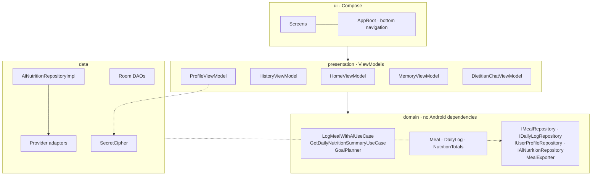
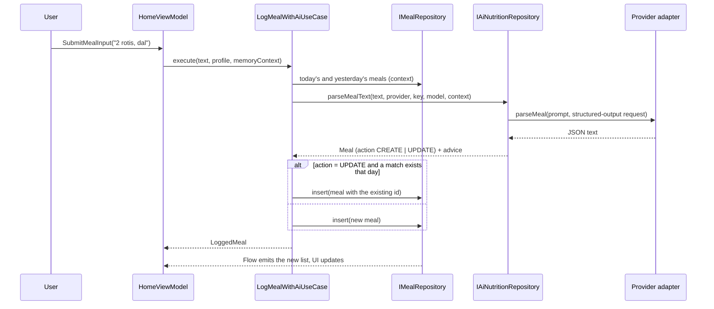

# Architecture

## Goals

1. **Private by default.** No backend of ours. Data lives on the device; the only network traffic is to the AI provider the user picked, with the user's own key.
2. **Provider independence.** Swapping or adding an LLM must not touch screens, ViewModels or use cases.
3. **Testable without a phone.** Business rules sit behind interfaces and take their clock, storage and network as parameters, so most behaviour is verified with plain JVM tests.
4. **Fail visibly, never silently.** AI and network failures reach the user as a message; storage failures never corrupt the log.

## Layers

The dependency rule points inward: `domain` knows nothing about Room, OkHttp or Compose. Hilt (`di/`) binds the interfaces to their implementations.

## Logging a meal (the main flow)

Room exposes `Flow`s, so the screen never needs to be told to refresh: inserting a meal changes today's list, totals and the analytics summaries on its own.

## Data

| Table | Purpose | Notes |
| :-- | :-- | :-- |
| `meals` | The food log | One row per entry; the id is stable so undo can restore a deleted row |
| `daily_logs` | Creatine taken and water per day | Updated with atomic SQL (`waterMl = MAX(0, waterMl + :ml)`) |
| `weights` | Weigh-in history | Feeds the trend sent to the dietitian |
| `memories` | Facts the dietitian remembers | Editable by the user and by the AI |

The schema is exported to `app/schemas`, and migrations are tested by building a database at an old version and opening it with the current one (`RoomMigrationTest`).

The profile and targets live in `SharedPreferences` as JSON. API keys are the exception: they are removed from that JSON and stored as separate AES-256-GCM tokens whose key is held by the Android Keystore ([ADR 0003](docs/adr/0003-encrypt-api-keys-with-keystore.md)).

## AI integration

`IAiProviderAdapter` is the only thing that knows a provider's URL, auth header and response shape. Shared pieces (JSON POST and error unwrapping, the meal response schema, response readers) are in `data/remote/adapter`. `AiNutritionRepositoryImpl` builds the prompt (`MealPrompts`), chooses the adapter, and turns the model's JSON into a `Meal`, tolerating the usual model quirks (markdown fences, numbers as strings, missing fields).

Every adapter is pinned by `AdapterContractTest` against a local `MockWebServer`: request path, auth header, default model, "key never in the URL", error message unwrapping, empty and malformed bodies, timeouts, and Gemini's fallback to a stable model when the requested one is missing.

## Concurrency and state

- ViewModels expose `StateFlow<UiState>` built with `combine(...).stateIn(WhileSubscribed(5s))`, so work stops when the screen is gone.
- One-shot events use a buffered `Channel` exposed as a `Flow` (`UiEffect`), so they are not replayed on rotation.
- Disk and network work runs on `Dispatchers.IO` inside the repositories; ViewModels stay main-safe.

## Testing strategy

| Level | What | Tools |
| :-- | :-- | :-- |
| Pure logic | Use cases, goal planning, totals, mapping, cipher | JUnit |
| State holders | ViewModels with fake repositories | coroutines-test, Turbine |
| Storage | Real DAOs, migrations | Robolectric + in-memory SQLite |
| Network | Provider wire contracts | MockWebServer |
| Wiring | Real app, real Hilt graph, navigation, one interaction | Robolectric + Compose test |

## Known trade-offs

- **SharedPreferences for the profile.** Small, single-writer data; DataStore would be the next step if the profile grows.
- **Mixed responsibilities in two screens.** `ProfileDetailsCard` and the chat parser are still large; they are tracked in the detekt baseline rather than hidden.
- **No instrumented tests yet.** The Keystore-backed cipher is tested with an in-memory key; the Keystore provider itself needs a device.
