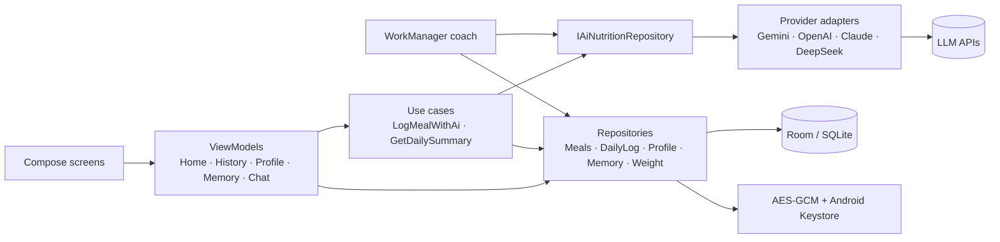

# CalorieTracker AI

**An offline-first Android nutrition tracker where you log meals in plain language (or with a photo) and the AI dietitian of your choice does the arithmetic. Your data stays on your phone and your API keys are encrypted with the Android Keystore.**

[](https://github.com/dipesh9765/calorie-tracker/actions/workflows/android-ci.yml)
[](https://kotlinlang.org/)
[](https://developer.android.com/jetpack/compose)
[](https://dagger.dev/hilt/)
[](LICENSE)

Type *"2 rotis with dal and a scoop of whey"*, or *"yesterday night I had saoji chicken"*, or take a photo of the plate. The app resolves the date, estimates calories and macros for the portion, saves the meal, and coaches you against your own targets.

## Highlights

- **Bring your own model.** Gemini, OpenAI, Anthropic Claude or DeepSeek behind one adapter interface, each using the provider's native structured output (Gemini `responseSchema`, OpenAI strict `json_schema`) so replies are machine-readable.
- **A dietitian that asks questions.** Chat mode asks short follow-ups when a portion, oil/ghee or brand is unclear, accepts photos (Gemini, OpenAI, Claude), and keeps long-term memory of your supplements, habits and allergies.
- **Natural-language dates.** "Yesterday", "last night", "on Sept 8" resolve to ISO dates; the model can also *update* an earlier entry instead of duplicating it.
- **Targets that fit you.** Mifflin-St Jeor BMR, activity level, goal pace with a safe cap and calorie floor; carbs and fat derived from your calorie and protein targets. Weight history feeds the coach as a trend.
- **Daily habits.** Creatine and water tracking stored per day, with analytics and a day-detail view.
- **Proactive coaching.** A WorkManager job posts a short, personalised nudge every couple of hours during the day (falls back to plain numbers when offline).
- **Private by design.** No backend, no account, no analytics. Meals, weights and memories live in a local Room database; cloud backup and device transfer are disabled; API keys are encrypted at rest.

## Architecture



Unidirectional data flow: each screen collects one immutable `UiState` from its ViewModel and sends events back; one-shot messages (toasts, undo snackbars) are separate `UiEffect`s. Dependencies are wired with Hilt; time comes from an injected `Clock`. Details and the reasoning behind the main choices are in [ARCHITECTURE.md](ARCHITECTURE.md) and [docs/adr](docs/adr).

```
app/src/main/java/com/calorietracker/app/
├── di/             Hilt modules (database, HTTP, adapters, repository bindings)
├── domain/         Meal, DailyLog, repository interfaces, use cases, GoalPlanner (no Android deps)
├── data/
│   ├── local/      Room entities, DAOs, migrations (schemas exported to app/schemas)
│   ├── remote/     Provider adapters + shared HTTP/schema helpers
│   ├── repository/ Room-backed repositories, AI repository, prompts
│   └── security/   AES-GCM cipher + Keystore key provider
├── presentation/   ViewModels and UI state
├── notification/   Coach worker, scheduler, notification helper
└── ui/             Compose screens, components, theme, app root
```

## Engineering quality

| Area | What is in place |
| :-- | :-- |
| Tests | 149 JVM unit tests: use cases, ViewModels (Turbine), Room DAOs and **migrations v1→v4** on SQLite (Robolectric), per-provider **wire contracts** against MockWebServer, cipher and key-storage behaviour, and a smoke test that boots the real app with the real Hilt graph |
| Coverage | Kover, 71.6% line coverage of non-UI code, 60% enforced in CI |
| Static analysis | ktfmt (Spotless), detekt (near-empty baseline), Android Lint with `abortOnError` |
| Security | Keys encrypted with AES-256-GCM (Keystore-held key), cleartext traffic off, backup off, keys redacted from `toString`, CSV export neutralises spreadsheet formulas. See [SECURITY.md](SECURITY.md) |
| Release | R8 minify + resource shrinking, tag-triggered signed release workflow, no auto-publishing from `main` |

## Getting started

Requirements: JDK 17, Android SDK 36 (min SDK 26, target 35), a current Android Studio (AGP 8.13).

```bash
git clone https://github.com/dipesh9765/calorie-tracker.git
cd calorie-tracker
echo "sdk.dir=/path/to/Android/Sdk" > local.properties   # Android Studio does this for you
./gradlew assembleDebug                                   # app/build/outputs/apk/debug
```

Open the app, go to **Profile**, pick a provider and paste your API key (stored encrypted on the device), then fill in your details to generate targets.

### Commands

| Command | What it does |
| :-- | :-- |
| `./gradlew testDebugUnitTest` | Run all unit tests |
| `./gradlew koverHtmlReportDebug` | Coverage report in `app/build/reports/kover` |
| `./gradlew spotlessApply` | Format the code |
| `./gradlew detekt lintDebug` | Static analysis |
| `./gradlew assembleRelease` | Minified release APK (signed only if a keystore is configured) |

### Signed releases

Push a version tag (`git tag v1.1.0 && git push origin v1.1.0`) and the [release workflow](.github/workflows/release.yml) builds the APK and attaches it to a GitHub release. To sign it, add the repository secrets `KEYSTORE_BASE64`, `KEYSTORE_PASSWORD`, `KEY_ALIAS` and `KEY_PASSWORD`. Without them the APK is built unsigned.

## Privacy

Meal text, photos you attach in chat, and the context needed for a good answer (today's totals, your targets, remembered facts) are sent to the AI provider **you** choose, using **your** key. Nothing is sent anywhere else. See [PRIVACY.md](PRIVACY.md).

## Known limitations

- Calorie and macro values are model estimates, not medical advice.
- No iOS or web client, and no cloud sync by design.
- Instrumented tests (real device Keystore, camera and photo picker, notification permission) are not part of CI yet; those paths are covered up to what Robolectric emulates.
- The Today screen follows the date at launch; leaving the app open across midnight shows the previous day until it is reopened.

## Contributing and license

See [CONTRIBUTING.md](CONTRIBUTING.md). Released under the [MIT License](LICENSE).
